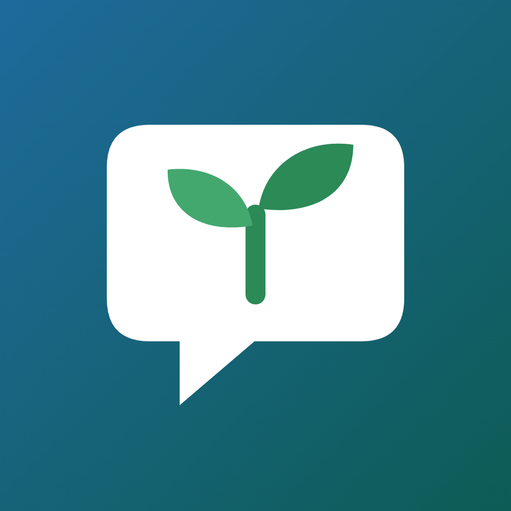
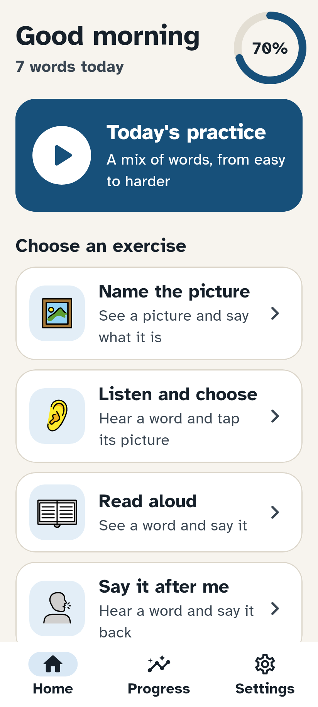
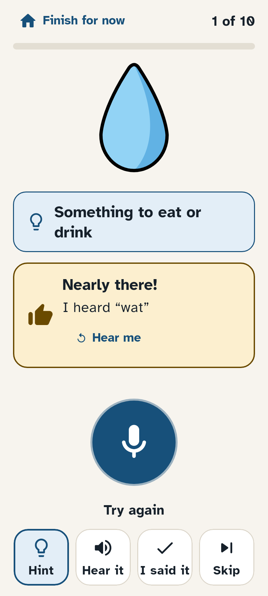
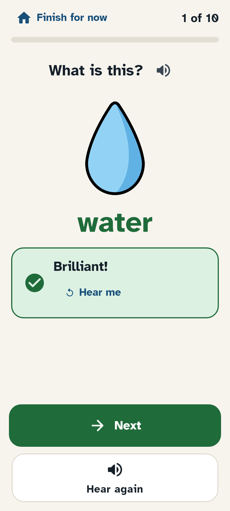
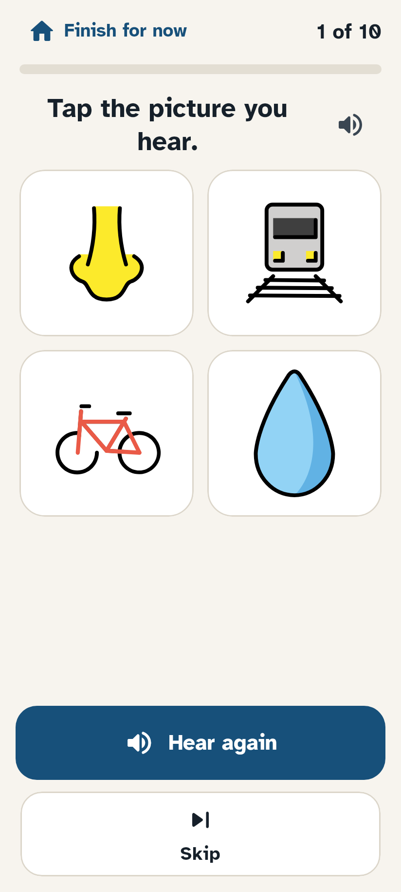
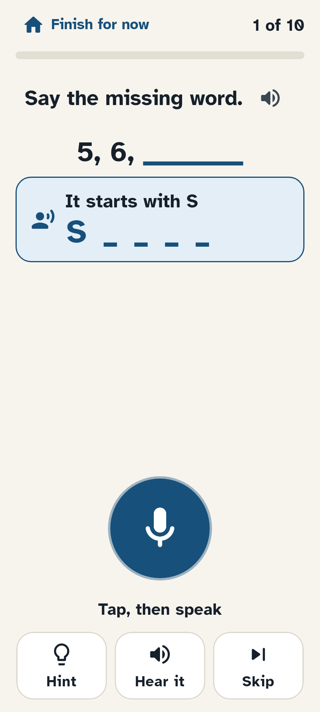
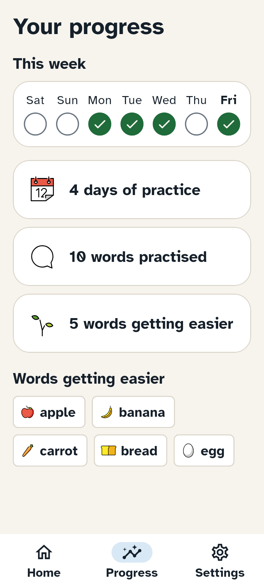
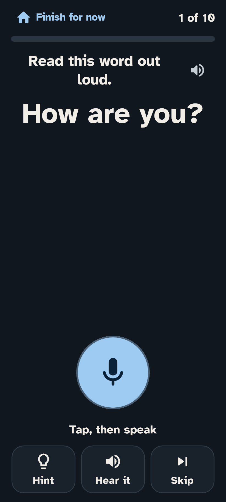
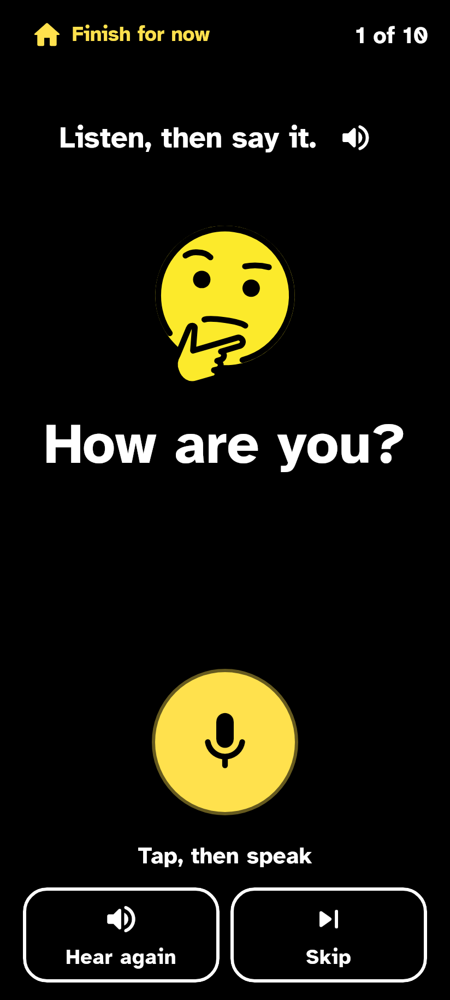
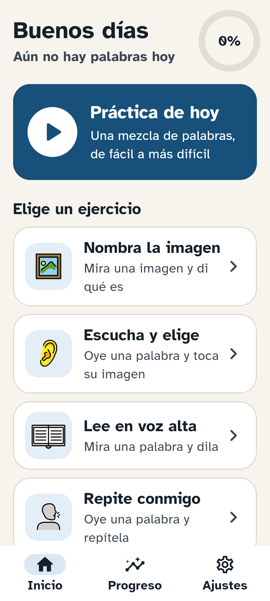

<h1 align="center">
  <br>
  Speakagain
</h1>

<p align="center">
  <strong>Free speech practice for people with aphasia, in many languages.</strong><br>
  Name pictures, repeat words and finish sentences every day, on a phone, tablet or computer.<br>
  Large, calm screens, encouraging feedback, and speech checking that runs on the device.
</p>

<p align="center">
  <a href="https://github.com/lobojoel2003/Speakagain/actions/workflows/ci.yml"></a>
  <a href="https://github.com/lobojoel2003/Speakagain/releases/latest"></a>
  <a href="LICENSE"></a>
  
  
  
</p>

| Today's practice | A gentle hint | Said it! | Listen and choose |
|---|---|---|---|
|  |  |  |  |

| Finish the sentence | Your progress | Dark | High contrast | Español |
|---|---|---|---|---|
|  |  |  |  |  |

<sub>Rendered from the app by its own screenshot test (<code>test/screenshots_test.dart</code>), which CI runs on every change.</sub>

## Contents

- [Why Speakagain](#why-speakagain)
- [What it does](#what-it-does)
- [Languages](#languages)
- [Install](#install)
- [How practice works](#how-practice-works)
- [Speech checking](#speech-checking)
- [Voices](#voices)
- [Exercise packs](#exercise-packs)
- [Privacy](#privacy)
- [Building from source](#building-from-source)
- [Project layout](#project-layout)
- [Versions, releases and CI/CD](#versions-releases-and-cicd)
- [Contributing](#contributing)
- [Licence and credits](#licence-and-credits)

## Why Speakagain

Aphasia, most often after a stroke, takes away words. Recovery needs a lot of practice, every day,
but therapy sessions are few and far between, and the best practice apps are paid and mostly
English-only:

- **Constant Therapy** costs $29.99 a month or $299.99 a year
  ([pricing](https://constanttherapyhealth.com/constant-therapy/for-patients/pricing/)), and it is
  English only ([UK Stroke Association](https://www.stroke.org.uk/stroke/effects/aphasia/therapy-apps/constant-therapy)).
- **Tactus Therapy** apps cost $5 to $25 each
  ([National Aphasia Association](https://aphasia.org/aphasia-resources/aphasia-apps/)).
- Free options exist, such as Lingraphica's **TalkPath Therapy**, and
  **[Project QWERTY](https://github.com/project-qwerty/project-qwerty)** (GPL-3.0), a free website
  for practising spelling and typing.

The gap is **many languages**, **offline use**, and **exercise packs that the community can add to**.
Speakagain is built for that gap:

| Need | Speakagain |
|---|---|
| Practise in your own language | App text and starter packs in 11 languages, including right-to-left Arabic. |
| No internet, no account, no subscription | Practice, progress and speech checking all run on the device. |
| Hard to read, one hand free | Large calm screens, every button has an icon, controls sit within thumb reach, instructions are read out loud. |
| Motivating, never discouraging | Encouraging feedback. Never a red cross. Help comes in small steps. |
| More practice material | Packs are plain JSON plus pictures. Anyone can make one, and the app imports them from a file. |

**Project QWERTY** was studied before starting: it is a Vue website focused on spelling and typing,
in English. Speakagain covers the speaking side (naming, repetition, reading aloud, sentence
completion, listening) and many languages, so the two complement each other. The cueing order and
the "practise one category at a time" idea are shared ground with QWERTY and with speech therapy
practice in general.

## What it does

- **Five exercises**
  - **Name the picture**: see a picture, say what it is (confrontation naming).
  - **Listen and choose**: hear a word, tap its picture out of 2, 3 or 4 (no speaking needed).
  - **Read aloud**: see a word, say it.
  - **Say it after me**: hear a word or phrase, say it back (repetition).
  - **Finish the sentence**: say the missing word: *"You sleep in a ___."*, *"Monday, Tuesday, ___"*.
- **Today's practice** mixes them, from easier to harder for each word (hear it and repeat, pick its
  picture, read it, then name it), and brings back words when they're due (spaced repetition).
- **Help in small steps**, the cueing order speech therapists use: a meaning hint (*"Something to eat
  or drink"*), then the first letter (*"It starts with W: W _ _ _ _"*), then hearing the whole word
  to say together. Help is offered after a try that wasn't caught, or any time with **Hint** and
  **Hear it**.
- **Speech checking on the device** with OpenAI's Whisper, and an **I said it** button that always
  works, so a carer or the person can confirm an answer the recogniser missed.
- **Hear yourself**: play back the last try.
- **Encouraging feedback**: *"You said it!"*, *"Nearly there! I heard 'wat'"*, *"Let's say it
  together."* A soft chime and a green tick for success; warm amber for "nearly". No red, no crosses,
  no scores to lose, no streaks to break.
- **Progress** as encouragement: the week's practice days, words practised, and words getting easier.
- **Starter packs** in every language: *Everyday words* (50 pictured words), *Finish the sentence*
  (18), *Counting and days* (15) and *Useful phrases* (16).
- **Readable for everyone**: [Atkinson Hyperlegible](https://www.brailleinstitute.org/freefont/)
  (a font designed for low vision), text sizes up to 136 % on top of the phone's own setting, light,
  dark and high-contrast themes (WCAG AAA contrast), screen reader labels, and reduced motion.

## Languages

| Language | App text | Starter packs | Natural voice (download) | Phone's voice |
|---|:-:|:-:|---|:-:|
| English | ✓ | ✓ | Kristin (US), Cori (UK) | ✓ |
| Español | ✓ | ✓ | Davefx (Spain), Ald (Mexico) | ✓ |
| Français | ✓ | ✓ | Siwis | ✓ |
| Deutsch | ✓ | ✓ | Thorsten | ✓ |
| Italiano | ✓ | ✓ | – | ✓ |
| Português (Brasil) | ✓ | ✓ | Faber | ✓ |
| Nederlands | ✓ | ✓ | Pim | ✓ |
| Polski | ✓ | ✓ | Gosia, Darkman | ✓ |
| हिन्दी (Hindi) | ✓ | ✓ | – | ✓ |
| العربية (Arabic) | ✓ | ✓ | – | ✓ |
| 中文 (Mandarin, simplified) | ✓ | ✓ | – | ✓ |

Speech checking works in all of them; it is most reliable in English, Spanish, French, German,
Italian and Portuguese (see [Speech checking](#speech-checking)).

> [!NOTE]
> The non-English text and packs were written carefully but not yet reviewed by native-speaking
> speech and language therapists. Reviews and corrections are very welcome:
> see [CONTRIBUTING.md](CONTRIBUTING.md#languages).

## Install

Open the [latest release](https://github.com/lobojoel2003/Speakagain/releases/latest).

**Android** (7.0 or newer): download **one** APK on the device and open it.

| File | For |
|---|---|
| `Speakagain-<version>-android-arm64-v8a.apk` | Most phones and tablets from the last few years |
| `Speakagain-<version>-android-armeabi-v7a.apk` | Older or low-cost 32-bit devices |
| `Speakagain-<version>-android-x86_64.apk` | Chromebooks and emulators |
| `Speakagain-<version>-android-universal.apk` | Any device, if you're not sure |

**Web**: use it in any modern browser at
[lobojoel2003.github.io/Speakagain](https://lobojoel2003.github.io/Speakagain/) (when GitHub Pages
is switched on for the repository), or host `Speakagain-<version>-web.zip` on any web server. In a
browser the person confirms their own answers; speech checking and natural voices need the app.

**iPhone and iPad**: each release has an unsigned `Speakagain-<version>-ios-unsigned.ipa` for
sideloading tools that sign with your Apple ID, or [build it with Xcode](#building-from-source).

Each release lists SHA-256 checksums of every file and the Android signing certificate.

## How practice works

1. **Choose your language** on first start (each language is listed in its own script), hear a test
   word, and choose whether to download speech checking.
2. **Tap _Today's practice_**, or pick one exercise. A session is 10 words (5 to 20 in Settings).
3. **Tap the microphone and speak.** Recording stops by itself after a pause; the pause is long
   (1.4 seconds) because speech after a stroke can be slow, with gaps inside a word.
4. **Speakagain checks the answer** and responds:
   - said it: green tick, chime, the word in green, **Next**;
   - nearly or not caught: what it heard, a hint, **Try again**, **I said it**, **Hear me**;
   - after three tries it offers to say the word together, then you can move on. Skipping is fine.
5. **Every word is remembered.** Words said without help come back after 1, 2, 4, 7, then 14 days;
   words that needed help come back sooner.

A session can be stopped at any time with **Finish for now**; everything practised so far is kept.

## Speech checking

Spoken answers are checked by [Whisper](https://github.com/openai/whisper) (OpenAI, MIT licence),
run on the device by [sherpa-onnx](https://github.com/k2-fsa/sherpa-onnx), the same engine Saywell
uses for its voices. One small native library therefore does both speech checking and natural
voices, on Android and iOS.

| Model | Download | For |
|---|---|---|
| **Standard** (Whisper base, int8) | 81 MB | Most accurate; the default |
| **Small** (Whisper tiny, int8) | 44 MB | Older or slower phones |

- **Downloaded once**, inside the app (Settings › Speech checking) or during first start, from this
  repository's [models release](https://github.com/lobojoel2003/Speakagain/releases/tag/models-v1).
  Every file is checked against a SHA-256 sum built into the app. For devices that never go online,
  copy the files over and use **Install from a file**.
- **Smaller than upstream**: the Whisper decoders store their 51,865-word table in 8 bits instead of
  32, which makes the *base* download 81 MB instead of 160 MB with the same transcripts in our checks
  ([`tool/models/shrink_whisper_decoder.py`](tool/models/shrink_whisper_decoder.py)). The
  [Models workflow](.github/workflows/models.yml) rebuilds these files from pinned upstream archives
  and checks them byte for byte before publishing.
- **Forgiving by design**: recognisers find single words hard, and speech after a stroke may be
  slower or less clear. The answer counts if it appears anywhere in what was heard (*"an apple"*,
  *"apple apple"*), ignoring case, punctuation, accents, doubled letters and small slips, with a
  *Gently* or *Closely* setting. Accepted alternatives (plurals, regional words, digits) come from
  the pack. Part of a word earns *"Nearly there!"*.
- **Never the last word**: **I said it** is always there. Whisper is weaker in Hindi, Arabic,
  Chinese, Polish and Dutch than in English, Spanish, French, German, Italian and Portuguese, and
  it is not trained on aphasic speech. Speech checking is a helper, not a judge.

Why not Vosk or whisper.cpp, as first suggested? The official `vosk_flutter` package has not been
updated since 2023 and doesn't build with current Dart; whisper.cpp's Flutter bindings bring
FFmpeg along. sherpa-onnx runs the same Whisper models, is actively maintained, and also runs
Saywell's Piper voices, so Speakagain needs one native engine instead of two. Details:
[docs/speech.md](docs/speech.md).

## Voices

| Voice | How it works | Offline |
|---|---|---|
| **Phone's voice** (default) | The device's own text-to-speech: Android's engine, iOS voices, or the browser's. | When the language's voice is installed (most phones have it) |
| **Natural voices** | The neural [Piper](https://github.com/rhasspy/piper) voices from **Saywell**, run by sherpa-onnx. 10 voices in 7 languages, about 63 MB each plus 9 MB of shared pronunciation data, downloaded once. | Always |

Like Saywell, Speakagain only lists voices whose model card states a clear licence for the
training data, and shows that licence next to each voice. If a natural voice can't speak, the
phone's voice takes over, so **Hear it** always makes a sound. Speed can be *Slower* (the default)
or *Normal*.

## Exercise packs

A pack is a folder with a `pack.json` and, optionally, an `images/` folder:

```json
{
  "format": 1,
  "id": "en-kitchen",
  "version": "1.0.0",
  "language": "en",
  "title": "In the kitchen",
  "exercises": ["name", "listen", "read", "repeat", "complete"],
  "categories": { "kitchen": "Something in the kitchen" },
  "items": [
    { "id": "spoon", "answer": "spoon", "accept": ["spoons"], "image": "openmoji:1F944", "category": "kitchen",
      "sentence": "You eat soup with a ___." },
    { "id": "kettle", "answer": "kettle", "image": "images/kettle.jpg", "category": "kitchen" }
  ]
}
```

- Pictures are any of the 2,456 [OpenMoji](https://openmoji.org/library/) symbols bundled with the
  app (the same set Saywell bundles), by code, or your own PNG, JPG, WebP or SVG files.
- **Add a pack in the app**: Settings › Exercise packs › *Add a pack from a file* (a `.zip` of the
  folder, or a bare `pack.json` that only uses OpenMoji symbols).
- **Share it with everyone**: put the folder in `assets/packs/<language>/` and open a pull request.
  CI checks it against [the JSON schema](schema/pack.schema.json) and the app's own rules.

The full guide, with every field and tips from aphasia therapy, is in [docs/packs.md](docs/packs.md).

## Privacy

No account, no ads, no analytics, no tracking. Practice history stays on the device, and a spoken
answer is kept only until the next word, for **Hear me**. The internet is used only when the person
chooses to download speech checking or a voice. See [PRIVACY.md](PRIVACY.md).

## Building from source

You need [Flutter 3.47.9](https://docs.flutter.dev/get-started/install) (the version CI uses). For
Android, also the Android SDK and JDK 17+; for iOS, Xcode on a Mac.

```bash
git clone https://github.com/lobojoel2003/Speakagain.git
```

```bash
cd Speakagain && flutter pub get
```

```bash
flutter run
```

Release builds:

```bash
flutter build apk --release --split-per-abi -Pforce-version-code-ignoring-abi=true
```

```bash
flutter build web --release --no-web-resources-cdn
```

```bash
flutter build ios --release
```

Checks (the same as CI):

```bash
dart format --output=none --set-exit-if-changed lib test && flutter analyze --fatal-infos
```

```bash
flutter test --exclude-tags screenshots
```

```bash
flutter test --tags screenshots
```

The last one renders the README screenshots into `build/screenshots/`.

Helper scripts (Python 3, no dependencies unless noted):

| Script | What it does |
|---|---|
| `tool/version.py` | Checks the version, build number, changelog and tag agree; prints release notes |
| `tool/sync_pack_assets.py` | Lists every pack folder in `pubspec.yaml` (Flutter asset folders aren't recursive) |
| `tool/sync_symbols.py` | Bundles the OpenMoji symbols from the pinned npm package (and checks every one in use is there) |
| `tool/models/build_models.py` | Builds the models release (needs `tool/models/requirements.txt`) |
| `tool/models/check_catalog.py` | Checks every model file in the catalog can be downloaded |

## Project layout

| Path | What |
|---|---|
| `lib/core/` | Answer matching, text normalisation for 11 languages, the session planner, languages |
| `lib/models/` | Packs (format and validation), progress (spaced repetition), settings |
| `lib/services/` | Storage, pack import, model downloads, speech (sherpa-onnx in a background isolate, microphone with end-of-speech detection, text-to-speech) |
| `lib/ui/` | Theme, screens and widgets |
| `lib/l10n/` | App text: `app_<language>.arb` |
| `assets/packs/<language>/<pack-id>/` | Starter packs |
| `assets/symbols/openmoji/` | 2,456 OpenMoji symbols, the same set as Saywell (CC BY-SA 4.0) |
| `assets/models/catalog.json` | Downloadable speech models and voices, with sizes and SHA-256 sums |
| `schema/pack.schema.json` | JSON schema for packs |
| `test/` | Unit, widget and screenshot tests |
| `tool/` | Release, asset and model scripts |
| `docs/` | Guides: packs, speech, architecture, releasing |

More detail: [docs/architecture.md](docs/architecture.md).

## Versions, releases and CI/CD

Speakagain follows [Semantic Versioning](https://semver.org). The version is in `pubspec.yaml` as
`MAJOR.MINOR.PATCH+BUILD`, and the build number is `MAJOR × 10000 + MINOR × 100 + PATCH`
(1.0.0 → 10000). It becomes the Android `versionCode` and the iOS `CFBundleVersion`, so every
release installs as an update. CI builds also show their run number and commit on the About screen.

| Workflow | When | What |
|---|---|---|
| [CI](.github/workflows/ci.yml) | Every push and pull request | Version and asset checks, pack schema, formatting, analysis, 100+ tests, screenshots, then Android APKs, the web app and an unsigned iOS build, as downloadable artifacts; model links |
| [Release](.github/workflows/release.yml) | A `vX.Y.Z` tag, or *Run workflow* on `main` | CI, then signed APKs (per processor and universal), an App Bundle, the web app, an unsigned iOS build, checksums and notes from [CHANGELOG.md](CHANGELOG.md) as a GitHub Release; the web app to GitHub Pages |
| [Models](.github/workflows/models.yml) | A `models-vN` tag | Rebuilds the speech models and voices from pinned sources, checks them byte for byte, publishes the models release |

How to release: [docs/releasing.md](docs/releasing.md).

## Contributing

Packs, translations, bug reports and code are all welcome, and so are reports from people with
aphasia, families and speech and language therapists about what helps. Please read
[CONTRIBUTING.md](CONTRIBUTING.md) and the [code of conduct](CODE_OF_CONDUCT.md). Security
problems: [SECURITY.md](SECURITY.md).

## Licence and credits

Speakagain is free software under the [GNU General Public License v3.0 or later](LICENSE).
The starter packs are [CC BY-SA 4.0](https://creativecommons.org/licenses/by-sa/4.0/).

It builds on:

- **[Saywell](https://github.com/lobojoel2003/Saywell)**: the symbol set and the natural voices.
- **[OpenMoji](https://openmoji.org)** symbols, [CC BY-SA 4.0](https://creativecommons.org/licenses/by-sa/4.0/).
- **[OpenAI Whisper](https://github.com/openai/whisper)** (MIT) and
  **[sherpa-onnx](https://github.com/k2-fsa/sherpa-onnx)** (Apache 2.0) with
  [ONNX Runtime](https://github.com/microsoft/onnxruntime) (MIT).
- **[Piper](https://github.com/rhasspy/piper)** voices (licence in each model card, shown in the app)
  and [eSpeak NG](https://github.com/espeak-ng/espeak-ng) data (GPL-3.0-or-later).
- **[Atkinson Hyperlegible](https://www.brailleinstitute.org/freefont/)** by the Braille Institute
  (SIL Open Font License).
- Flutter and the packages listed in [`pubspec.yaml`](pubspec.yaml); their licences are shown in
  the app under About › Licences.
